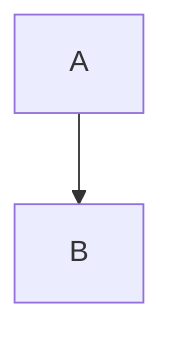

# Contribution Guide

Welcome to the Cap Collective contributor community! This guide covers everything you need to know to contribute effectively.

---

## Ways to Contribute

| Type | Examples | Difficulty |
|------|----------|------------|
| **Documentation** | Fix typos, add examples, translate, improve clarity | ⭐ Easy |
| **Curriculum** | New lesson plans, worksheets, assessments, standards mapping | ⭐⭐ Medium |
| **CAD Designs** | New molds, boxes, jigs, parametric improvements | ⭐⭐ Medium |
| **Code** | Dashboard features, sensor firmware, Apps Script, CI/CD | ⭐⭐⭐ Hard |
| **Hardware** | Equipment mods, new sensor designs, safety improvements | ⭐⭐⭐ Hard |
| **Community** | Answer questions, mentor, translate, organize events | ⭐ Easy |
| **Testing** | Beta test firmware, curriculum, dashboard, report bugs | ⭐⭐ Medium |
| **Grants/Funding** | Write templates, share opportunities, review applications | ⭐⭐ Medium |

---

## Getting Started

### 1. Join the Community
- **Discord:** [discord.gg/capcollective](https://discord.gg/capcollective) — introduce yourself in #introductions
- **GitHub:** Watch [github.com/imredavid64-glitch/capcollective](https://github.com/imredavid64-glitch/capcollective)
- **Email List:** support@capcollective.org for announcements

### 2. Find Your First Issue
- **Good First Issue** label: [GitHub Issues](https://github.com/imredavid64-glitch/capcollective/labels/good%20first%20issue)
- **Help Wanted** label: needs community input
- **Documentation** label: writing/editing tasks

### 3. Set Up Local Environment

#### Documentation (Markdown)
```bash
# No build needed — edit .md files directly
# Preview: any Markdown viewer (VS Code, Obsidian, Typora)
```

#### Dashboard (Next.js)
```bash
cd cap-collective-dashboard
npm install
cp .env.example .env.local
# Add your Supabase credentials
npm run dev
# http://localhost:3000
```

#### Firmware (PlatformIO)
```bash
# Install PlatformIO (VS Code extension or CLI)
cd firmware/node1_cap_counter
pio run -t upload
pio device monitor
```

### 4. Make Your First Contribution
1. Fork the repo
2. Create branch: `git checkout -b feat/your-feature-name`
3. Make changes
4. Test locally
5. Commit: `git commit -m "feat: add amazing feature"`
6. Push: `git push origin feat/your-feature-name`
7. Open Pull Request

---

## Contribution Standards

### Code Style

#### TypeScript/JavaScript (Dashboard)
```typescript
// Use TypeScript strict mode
// ESLint + Prettier (run: npm run lint)
// Functional components + hooks
// Descriptive names: getStudentLeaderboard() not getData()
// JSDoc for public functions
```

#### Python (Data Science/AI)
```python
# Black formatter (line length 88)
# Type hints required
# Docstrings: Google style
# Pytest for tests
```

#### C++ (Firmware)
```cpp
// Arduino style guide
// 2-space indent
// Descriptive names: capCount not cnt
// Comments for non-obvious logic
// PlatformIO.ini for dependencies
```

#### Markdown (Documentation)
```markdown
# ATX headers (# ## ###)
- Tables for structured data
- Mermaid for diagrams
- Code blocks with language
- Relative links (./file.md)
- Alt text for images
```

### Commit Messages
Follow [Conventional Commits](https://www.conventionalcommits.org/):

```
feat: add student leaderboard widget
fix: correct shredder jam detection logic
docs: update safety checklist with new PPE
style: format dashboard components with prettier
refactor: extract sensor parsing to utility
test: add unit tests for cap count parser
chore: update dependencies
```

Types: `feat`, `fix`, `docs`, `style`, `refactor`, `test`, `chore`, `perf`, `ci`, `build`, `revert`

### Pull Request Process

#### PR Template
```markdown
## Description
Brief summary of changes

## Type
- [ ] Bug fix
- [ ] New feature
- [ ] Documentation
- [ ] Refactor
- [ ] Performance
- [ ] Test

## Testing
- [ ] Tested locally
- [ ] Added unit tests
- [ ] Manual verification steps:
  1. Step one
  2. Step two

## Screenshots (if UI)
| Before | After |
|--------|-------|
|  |  |

## Checklist
- [ ] Code follows style guide
- [ ] Self-review completed
- [ ] Documentation updated
- [ ] Tests pass
- [ ] No breaking changes (or documented)
```

#### Review Criteria
- [ ] Solves the stated problem
- [ ] Code is readable and maintainable
- [ ] Tests pass (or new tests added)
- [ ] Documentation updated
- [ ] No security vulnerabilities
- [ ] Performance acceptable
- [ ] Follows project conventions

---

## Specific Contribution Areas

### 1. Documentation
**Where:** `/docs/` and root `.md` files

**Needed:**
- Typos, clarity, formatting
- Missing sections (check TODOs)
- Translations (ES, FR, DE, ZH, AR, etc.)
- Platform-specific guides (Windows/Mac/Linux)
- Video scripts for training library
- Accessibility improvements (alt text, headings)

**Style:**
- Second person ("you")
- Active voice
- Concrete examples
- Code blocks with language
- Mermaid diagrams for flows
- Tables for structured data

### 2. Curriculum
**Where:** `/docs/curriculum/` and `/templates/`

**Needed:**
- New lesson plans (template in `/templates/lesson-plan.md`)
- Worksheets for existing lessons
- Standards alignment for new states/countries
- Differentiation strategies
- Assessment rubrics
- Translations
- Student work exemplars

**Requirements:**
- 5E model (Engage, Explore, Explain, Elaborate, Evaluate)
- Standards codes (NGSS, CCSS, State)
- Safety notes
- Differentiation table
- Materials list with quantities
- Time estimates
- Assessment criteria

### 3. CAD Designs
**Where:** `/cad/` and `/docs/technical/cad.md`

**Needed:**
- New molds (keychains, badges, pots, tiles, organizers)
- Parametric improvements (easier customization)
- New box designs (different sizes, features)
- Jigs and fixtures (sieve holder, cooling rack)
- CNC toolpaths (Fusion 360 .f3d + .nc)
- Bill of materials for each design

**Requirements:**
- Parametric (variables at top)
- Comments explaining design choices
- Export instructions (DXF for laser, STL for print)
- Print settings (material, layer, infill, supports)
- DFM notes (draft angles, wall thickness, vents)

### 4. Dashboard (Next.js)
**Where:** `/cap-collective-dashboard/`

**Tech Stack:** Next.js 14, TypeScript, Tailwind, Recharts, Supabase

**Areas to Contribute:**
- New chart types (heatmap, funnel, sankey)
- Real-time features (Supabase subscriptions)
- Mobile responsiveness
- Accessibility (WCAG 2.1 AA)
- Performance (bundle size, caching)
- Internationalization (i18n)
- PWA features (offline, install)
- Admin panels (user management, settings)

**Development:**
```bash
npm run dev        # Local dev
npm run build      # Production build (static export)
npm run lint       # ESLint + Prettier
npm run test       # Jest + React Testing Library
```

### 5. Firmware (ESP32/ESP32-S3)
**Where:** `/firmware/`

**Platforms:** ESP32, ESP32-S3 (PlatformIO)

**Areas to Contribute:**
- New sensor drivers (temp, humidity, weight, fill-level)
- Power management (deep sleep, solar)
- Mesh networking (ESP-NOW, LoRa)
- OTA updates
- Safety watchdogs
- Calibration routines
- Unit tests (Unity framework)

**Hardware Targets:**
- Node 1: ESP32-S3 CAM + ultrasonic + color
- Node 2: ESP32 + IR/ultrasonic
- Radio Tower: ESP32-S3 + TFT + OLED + SD + Supabase

### 6. Data Science / AI
**Where:** `/docs/curriculum/data-science.md` and `/cap-collective-dashboard/src/lib/`

**Areas:**
- Collection forecasting (ARIMA, Prophet, LSTM)
- Anomaly detection (sensor faults, contamination)
- Color classification (TFLite on ESP32-S3)
- LCA automation (OpenLCA API)
- Supply chain optimization (OR-Tools)
- Student performance prediction
- Grant success prediction

---

## Testing Guidelines

### Unit Tests
- **Coverage target:** 80%+ for new code
- **Frameworks:** Jest (TS/JS), Pytest (Python), Unity (C++)
- **Naming:** `describe("feature", () => { it("should...", () => {}) })`

### Integration Tests
- Dashboard: Cypress (E2E)
- Firmware: Hardware-in-loop (GitHub Actions self-hosted)
- Apps Script: clasp + local test harness

### Manual Testing Checklist
- [ ] Core user flows work
- [ ] Edge cases handled
- [ ] Error messages helpful
- [ ] Mobile responsive
- [ ] Keyboard navigable
- [ ] Screen reader tested (NVDA/VoiceOver)
- [ ] Color contrast ≥4.5:1
- [ ] Performance acceptable

---

## Documentation Standards

### Writing Style
- **Audience:** Teachers, students, admins, makers
- **Tone:** Encouraging, practical, precise
- **Structure:** Problem → Solution → Example → Troubleshooting
- **Length:** Concise but complete

### Formatting
```markdown
# H1: Page Title
## H2: Major Section
### H3: Subsection

**Bold** for emphasis
`code` for inline code
```language
code blocks
```

| Table | Header |
|-------|--------|
| Row   | Data   |

> **Note:** Important callouts
> **Tip:** Helpful hints
> **Warning:** Safety critical



### Diagrams
- Use Mermaid.js (renders in GitHub, MkDocs, Notion)
- Keep simple (<20 nodes)
- Consistent colors (Cap Collective palette)
- Accessible: text labels, not color-only

---

## Translation Guidelines

### Process
1. Copy English file → `filename.es.md` (ISO 639-1 code)
2. Translate content (not code blocks, not URLs)
3. Keep Mermaid diagrams in English (or translate labels)
4. Update `mkdocs.yml` nav for new language
5. PR with `[i18n]` prefix

### Priority Languages
1. Spanish (ES) — largest non-English
2. French (FR) — Canada, Africa, Europe
3. German (DE) — Europe, strong maker culture
4. Chinese (ZH) — massive education market
5. Arabic (AR) — MENA region
6. Portuguese (PT) — Brazil, Portugal
7. Japanese (JA) — strong tech education
8. Hindi (HI) — India scale

### Style
- Formal but accessible
- Metric units (include imperial in parentheses)
- Local curriculum references where possible
- Cultural sensitivity (images, examples, holidays)

---

## Security & Privacy

### Reporting Vulnerabilities
**DO NOT** open public issue. Email: security@capcollective.org

Include:
- Description
- Steps to reproduce
- Impact assessment
- Suggested fix (if known)

### Data Handling
- No PII in public repos
- Student data → Supabase (RLS) or Sheets (domain-restricted)
- Sensor data → anonymized (bin_id only)
- Photos → consent required, no names

---

## Recognition

### Contributor Levels
| Level | Criteria | Perks |
|-------|----------|-------|
| **Contributor** | 1+ merged PR | Name in CONTRIBUTORS.md |
| **Regular** | 5+ merged PRs | Discord role, early access |
| **Core** | 20+ PRs + reviews | GitHub write access, swag |
| **Maintainer** | Invited | Lead a domain, stipend eligible |

### Recognition
- All contributors in `CONTRIBUTORS.md`
- Release notes credit
- Discord announcements
- Conference travel (core maintainers)
- Conference speaking slots

---

## Code of Conduct

See [CODE_OF_CONDUCT.md](CODE_OF_CONDUCT.md) — enforced everywhere (GitHub, Discord, events).

**TL;DR:** Be respectful, inclusive, constructive. No harassment, discrimination, spam. Report violations to conduct@capcollective.org.

---

## Questions?

- **Discord:** #contributing channel
- **Email:** contribute@capcollective.org
- **Office Hours:** First Tuesday 4pm ET (calendar link in Discord)

---

## Quick Start Checklist

- [ ] Read this guide
- [ ] Join Discord
- [ ] Fork repo
- [ ] Pick "good first issue"
- [ ] Set up local env
- [ ] Make change
- [ ] Test
- [ ] Open PR
- [ ] Celebrate! 🎉

**Welcome to the team!** 🌉♻️