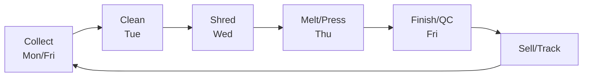

# Operations Playbook

Daily and weekly workflows for running Cap Collective smoothly.

---

## Weekly Workflow

| Day | Focus | Key Activities |
|-----|-------|----------------|
| **Mon** | Collect | Box checks, cap counts, log weights |
| **Tue** | Clean | Sort, soak, scrub, rinse, dry 24hrs |
| **Wed** | Shred | Feed, sieve 5-8mm, store by color |
| **Thu** | Press | Heat press cycles, cool, QC check |
| **Fri** | Finish | Sand, QC, package, sell, report |

---

## Collection System Setup

1. **Zone Mapping** — Audit high-traffic areas (cafeteria, gym, entry, library)
2. **Deploy Boxes** — 1 box per 150 students minimum
3. **Brand** — Student-designed signage ("Feed the Box!")
4. **Tech** — ESP32 + IR sensor → WiFi → Dashboard (optional)
5. **Schedule** — Student "Green Team" collects Fridays, weighs, logs

---

## Cleaning Protocol (CRITICAL)

*This is the most important step for quality.*

1. **Sort:** HDPE #2 vs PP #5 (check underside symbol)
2. **Remove liners:** Pull out silicone/foam inner seals (they don't melt!)
3. **Soak:** Warm water + dish soap, 10 min
4. **Scrub:** Old toothbrush for stubborn residue
5. **Rinse:** Until water runs clear
6. **Dry:** Air dry 24 hours on mesh (no towel — lint!)
7. **QC:** Any cap with adhesive/paper/liquid smell → reject

> **Why:** Residual milk/sugar burns at high temp → toxic fumes + discolored product.

---

## Shredding SOP (Grade 6+, Certified)

1. Clear blades of residual plastic
2. Toggle motor, verify rotation
3. **Feed slowly** — do not overfeed (stalls motor)
4. Target flake size: 5-8mm
5. Sieve through mesh screen (consistency)
6. Store in labeled buckets by color
7. Oil blades after each session

---

## Heat Press SOP (Grade 6+, Certified)

| Material | Temperature | Time |
|----------|-------------|------|
| HDPE (#2) | 140°C | 5 min + flip + 5 min |
| PP (#5) | 170°C | 5 min + flip + 5 min |
| **Never exceed** | **200°C** | — |

1. Turn on press, set temp & time
2. Wait for platen to reach FULL temp (verify with IR thermometer)
3. **Parchment sandwich:** flakes between two baking-paper sheets
4. Press 5 min → **flip** → press 5 min
5. Cool under weight (prevents warping)
6. Remove, measure thickness

⚠️ **WARNING:** Never let plastic touch the metal platen. Monitor constantly — thermal runaway is possible.

---

## Role Rotation Schedule

Rotate every **2 weeks** so all students experience multiple roles.

| Role | Responsibility | Certification | Grades |
|------|----------------|---------------|--------|
| Collection Captain | Zone mapping, box monitoring, Friday pickup | Safety + Data Entry | 3+ |
| Wash Station Lead | Cleaning protocol, liner removal, drying logs | Hygiene + Material ID | 3+ |
| Shredder Operator | Feeding, sieving, flake quality check | Shredder Safety (14+) | 6+ |
| Press Operator | Temp monitoring, parchment sandwich, timing | Heat Press Safety (14+) | 6+ |
| Design Engineer | Fusion 360/Tinkercad, mold design, QC | Design Software | 6+ |
| Data Analyst | Dashboard maintenance, trend reports, alerts | Sheets/Arduino | 6+ |
| Business Manager | Inventory, pricing, sales, marketing | Financial Literacy | 9+ |

See [Student Roles](student-roles.md) for rotation scheduler.

---

## Maintenance Schedule

| Task | Frequency | Responsible |
|------|-----------|-------------|
| Shredder blade oil | Weekly | Shredder Op |
| Clean press platen | Weekly | Press Op |
| Check ventilation filter | Monthly | Program Lead |
| Calibrate IR thermometer | Monthly | Data Analyst |
| Full safety audit | Termly | Program Lead |

---

## DO THIS NOW (Week 1-2)

- [ ] Complete zone mapping with students
- [ ] Order/build 3-5 boxes
- [ ] Print & post signage (see [Printables](../resources/printables.md))
- [ ] Schedule first collection day
- [ ] Assign role groups

---

See [Command Center](command-center.md) for data tracking and [Safety SOPs](../program/safety.md) for complete safety procedures.